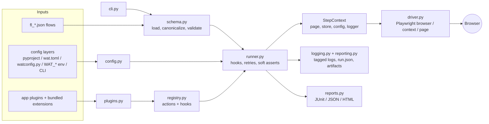

<div align="center">


# WAT - Web Auto Tester

**Declarative, JSON-flow-driven browser testing on Playwright - built for long, stateful,
multi-step user journeys, with failures you can attribute in seconds.**

[](https://github.com/leondavi/WAT/actions/workflows/ci.yml)


[](LICENSE)

[Motivation](#motivation) |
[Quick start](#quick-start) |
[Writing a flow](#writing-a-flow) |
[How it works](#how-it-works) |
[Extending WAT](#extending-wat) |
[Documentation](#documentation)

</div>

---

## What is WAT?

WAT runs end-to-end browser tests described as plain JSON files (`fl_*.json`, called
**flows**) against a real browser driven by [Playwright](https://playwright.dev/python/).
One shared engine is consumed by many apps (typically as a git submodule): each app
contributes its flows, a small config file, and optional plugins for app-specific
actions - the engine itself is never forked.

```json
{
  "name": "Login and open the dashboard",
  "label": "auth/smoke",
  "matrix": [{"email": "qa@example.com", "password": "secret"}],
  "steps": [
    {"action": "open", "url": "/login"},
    {"action": "type", "by": "label", "selector": "Email", "value": "{{email}}"},
    {"action": "type", "by": "label", "selector": "Password", "value": "{{password}}"},
    {"action": "click", "by": "role", "selector": "button", "name": "Sign in"},
    {"action": "wait_for_url", "value": "/dashboard"},
    {"action": "assert_element_text", "selector": "h1", "value": "Welcome"},
    {"action": "assert_no_console_errors"}
  ]
}
```

```bash
wat --flow flows/fl_login.json --base-url http://localhost:4000
```

## Motivation

### The problem

End-to-end tests for modern web apps - real-time UIs, chat assistants, spreadsheets,
LiveView/SPA frameworks - tend to decay in the same predictable ways:

1. **Every app grows its own test harness.** Teams start with a few Selenium scripts,
   then each project forks and patches its own runner. Fixes made in one copy never
   reach the others, and the forks drift until nobody trusts any of them.
2. **Tests are code, so they are expensive to write and review.** A ten-step user journey
   becomes a page of imperative boilerplate - locators, waits, retries, teardown - and the
   actual intent ("log in, open the sheet, check the total") gets buried.
3. **Flakiness is papered over with sleeps.** Without first-class waits and retries,
   authors reach for `time.sleep(5)` and inline JavaScript hacks, making suites slow
   *and* still flaky.
4. **A red build does not say who is at fault.** When a long journey fails at step 37,
   is it a bug in the test runner, a JavaScript error in the browser, the backend
   returning a 500, or simply a stale selector in the test? Answering that usually means
   re-running locally with a debugger attached.

### What WAT does about it

| Problem | WAT's answer |
|---|---|
| Forked, drifting harnesses | **One engine, many apps.** Apps consume WAT as a submodule and extend it through a plugin API (`@register_action`, hooks, login/reset providers) instead of editing it. |
| Tests are verbose code | **Flows are data.** A JSON step list with a documented catalog of ~80 actions and assertions. Flows are easy to diff, review, generate, and lint - `wat --validate-only` catches unknown actions, missing fields, and undefined `{{variables}}` without starting a browser. |
| Sleeps and flakiness | **Declarative robustness.** Playwright auto-waiting, plus per-step `timeout`, `retry`, `optional`, `soft`, and `if` / `skip_if` keys, explicit `wait_for*` actions, and network mocking. |
| "Whose bug is it?" | **Attributable diagnostics.** Every log line is tagged `[WAT]`, `[BROWSER]`, `[APP]`, or `[STEP]`; every failure is classified as `wat_engine`, `browser`, `app`, or `flow_authoring` in a machine-readable `run.json`, alongside a screenshot, DOM snapshot, Playwright trace, and a ready-to-paste repro prompt. |

### When to use WAT (and when not to)

WAT is a good fit when you want **many readable, reviewable journeys** shared across
one or more apps, run identically on a laptop and in CI. If you need arbitrary
programmatic control inside each test, plain `pytest-playwright` may suit you better -
and nothing stops you from mixing the two: any custom logic can be wrapped as a WAT
action in a few lines of Python.

## Features

- **~80 built-in actions** across navigation, interaction, browser/session state,
  network mocking, capture, and rich assertions (`wat --print-actions`).
- **Semantic locators** - `css`, `xpath`, `role`, `testid`, `text`, `label`, `placeholder`
  and more, with `has_text` and `index` refinements.
- **Variables and data-driven runs** - `capture` values into `{{vars}}` and run one
  flow per row of a `matrix`.
- **Reusable fragments** - compose flows from shared step lists via `use`.
- **Headless by default, live on demand** - `--live` opens a visible, slowed-down
  browser with streaming logs; `--pause-on-failure` drops into the Playwright Inspector.
- **Scales out** - `--all` reuses one browser across flows; `--workers N` runs in parallel;
  filter with `--label` / `--grep`.
- **CI reports** - JUnit XML, JSON, or a self-contained HTML report with inline screenshots.
- **Authoring tools** - `--record` turns a browser session into a draft flow;
  `--migrate` ports legacy Selenium flows; `--doctor` checks the environment.
- **Optional extensions** - Phoenix LiveView readiness and pushes, SQL / Docker seeding,
  visual regression (`assert_screenshot`), and accessibility checks (`assert_a11y`).

## Quick start

### Requirements

- Python 3.10+
- Playwright-supported OS (macOS, Linux, Windows). Browsers are installed by the installer.

### Install as a submodule (recommended for apps)

```bash
# 1. Add WAT to your app.
git submodule add https://github.com/leondavi/WAT.git tools/WAT
git submodule update --init

# 2. One-shot install: creates tools/WAT/.wat-venv, installs the package and
#    browsers, and self-verifies by running the hermetic example flows.
python tools/WAT/install.py --app myapp --extras liveview

# 3. Run a flow (headless).
tools/WAT/.wat-venv/bin/wat --flow flows/fl_smoke.json --base-url http://localhost:4000
```

### Install standalone (to try it out)

```bash
git clone https://github.com/leondavi/WAT.git && cd WAT
python -m venv .venv && source .venv/bin/activate
pip install -e ".[dev,visual]"
python -m playwright install chromium

wat --all --root .            # runs the bundled, network-free example flows
```

### Watching a run

```bash
wat --flow flows/fl_smoke.json --live                 # headed + slow-mo + live logs
wat --flow flows/fl_smoke.json --headed --slow-mo 500 --devtools
wat --flow flows/fl_smoke.json --headed --pause-on-failure
```

In live mode each step is announced before it runs (`-> [n] action target`) and browser
`console.error`, uncaught page errors, and failed requests stream to the `[BROWSER]`
channel as they happen.

## Writing a flow

A flow is a JSON object with a `steps` list; each step names an `action` plus its fields.

```json
{
  "name": "Checkout applies a discount code",
  "label": "shop/checkout",
  "matrix": [{"code": "SAVE10", "total": "$90.00"}, {"code": "SAVE20", "total": "$80.00"}],
  "steps": [
    {"action": "login"},
    {"action": "open", "url": "/cart"},
    {"action": "mock", "url": "**/api/recommendations", "body": []},
    {"action": "type", "by": "testid", "selector": "promo-input", "value": "{{code}}"},
    {"action": "click", "by": "role", "selector": "button", "name": "Apply"},
    {"action": "wait_for_text", "selector": "#total", "value": "{{total}}", "timeout": 5000},
    {"action": "capture", "selector": "#order-id", "store_as": "order_id", "optional": true},
    {"action": "assert_no_network_errors", "soft": true}
  ]
}
```

Highlights of the step model:

| Key | Purpose |
|---|---|
| `by` / `selector` / `has_text` / `index` | Locate an element (default `by` is `css`). |
| `timeout` | Per-step timeout in ms. |
| `retry` | Re-run a failing step N more times. |
| `optional` | A failure is logged but does not fail the flow. |
| `soft` | Record the assertion failure and keep going; the flow fails at the end. |
| `if` / `skip_if` | Run or skip a step based on a JavaScript predicate evaluated in the page. |
| `store_as` | Save a captured value into the `{{variable}}` store. |
| `comment` | Free-text documentation for reviewers. |

Validate before running - no browser needed:

```bash
wat --validate-only --all
```

See [`docs/authoring-flows.md`](docs/authoring-flows.md) and the full
[`docs/action-catalog.md`](docs/action-catalog.md). [`CONTRACT.md`](CONTRACT.md) is the
normative schema.

## Running many flows

```bash
wat --all                                   # one browser reused across all flows
wat --all --workers 4                       # parallel; one browser per worker
wat --all --label sheet/                    # filter by label prefix
wat --all --grep dataset                    # filter by substring (file / name / label)
wat --all --fail-fast                       # stop at the first failure
wat --all --report out.xml                  # JUnit for CI
wat --all --report out.html --report-format html   # self-contained HTML report
wat --list                                  # list discovered flows
```

Exit code is `0` when every flow passes and non-zero otherwise, so WAT drops into any CI
system. WAT's own pipeline ([`.github/workflows/ci.yml`](.github/workflows/ci.yml)) is a
working example: unit tests, `--doctor`, `--validate-only`, then a headless run of the
example flows with JUnit and HTML reports uploaded as build artifacts.

## How it works

### Architecture



### The life of a run

1. **Configure.** `config.py` merges settings from lowest to highest precedence:
   built-in defaults, `[tool.wat]` in `pyproject.toml`, `wat.toml`, `watconfig.py`
   (the only layer that may execute code - for dynamic values such as a docker-compose
   port), `WAT_*` environment variables, and finally the CLI flags you actually passed.
2. **Register.** Importing `wat` registers the core actions into a single registry.
   Configured extensions (`liveview`, `sql`, `visual`, `a11y`) and app plugins (a
   module path or a `.py` file) are then imported; their decorators add actions and
   hooks to the *same* registry, so a plugin action is indistinguishable from a
   built-in at dispatch time.
3. **Load and validate.** `schema.py` loads each flow, expands fragments, canonicalizes
   historical field spellings, and validates actions, required fields, and variable
   references - the same pass that powers `--validate-only`.
4. **Drive the browser.** `driver.py` is the *only* module that imports Playwright, and
   it does so lazily. It owns the browser, context, and page lifecycle, and attaches
   native listeners for console messages, page errors, and network failures - the data
   behind `assert_no_console_errors`, `assert_no_network_errors`, and the `[BROWSER]` log.
   With `--all`, one browser is reused across flows for fast startup.
5. **Execute steps.** `runner.py` walks the step list. For each step it interpolates
   `{{variables}}`, runs `before_step` hooks, dispatches to the registered handler with a
   `StepContext`, applies the step's `timeout` / `retry` / `optional` / `soft` /
   `if` semantics, and runs `after_step` hooks. `before_flow` / `after_flow` hooks, a
   login provider, and a per-flow reset hook bracket the whole flow.
6. **Report.** Every step is appended to `steps.jsonl`. On failure the runner saves a
   screenshot, DOM snapshot, Playwright trace, and `run.json`, classifies the failure
   source from the exception type (see [`errors.py`](src/wat/errors.py)), and writes an
   `agent_prompt.txt` that leads with that classification. Aggregate JUnit / JSON / HTML
   reports are written when `--report` is given.

### Design principles

- **Data over code.** Flows describe intent; handlers implement mechanics once.
- **Validate early.** Anything that can be caught without a browser is caught by
  `--validate-only`, so CI fails in seconds rather than minutes.
- **Browser-free core.** Everything except `driver.py` is pure Python, which keeps the
  engine unit-testable against a lightweight fake page.
- **Generic engine, specific plugins.** Framework- or app-specific behavior lives in
  extensions and plugins, never in the core.
- **Every failure has an owner.** Diagnostics are designed around one question:
  is it WAT, the browser, or the app?

### Repository layout

```
src/wat/
  cli.py            command-line entry point (wat / python -m wat)
  config.py         layered configuration loader
  schema.py         flow loading, canonicalization, validation
  runner.py         step dispatch, lifecycle hooks, retries, soft assertions
  driver.py         Playwright lifecycle + console/network capture
  registry.py       action and hook registries (the extension core)
  context.py        StepContext handed to every action and hook
  locators.py       selector kinds -> Playwright locators
  interpolate.py    {{variable}} templating
  logging.py        per-run, source-tagged logs
  reporting.py      failure artifacts, run.json, repro prompt
  reports.py        JUnit / JSON / HTML aggregate reports
  recorder.py       wat --record
  migrate.py        Selenium flow migration
  actions/          core actions (navigation, interaction, assertions, ...)
  ext/              opt-in extensions (liveview, sql, visual, a11y, auth)
flows/              hermetic example flows (run in CI, no server needed)
docs/               authoring guide, action catalog, diagnostics, migration
tests/              unit tests (no browser) + gated live-browser tests
```

## Extending WAT

Add an app-specific action in a few lines and point your config at the file:

```python
# tools/wat_plugin.py
from wat import register_action, login_provider, StepContext

@register_action("open_dashboard", required=("id",))
def open_dashboard(ctx: StepContext):
    ctx.page.goto(ctx.url(f"/dash/{ctx.field('id')}"))

@login_provider
def login(ctx: StepContext):
    ...  # sign in however your app needs
```

```toml
# wat.toml (app root)
base_url = "http://localhost:4000"
extensions = ["liveview"]
plugins = ["tools/wat_plugin.py"]
```

Plugins can also register `before_flow`, `after_flow`, `before_step`, and `after_step`
hooks, a per-flow reset hook, and custom report writers. Run `wat --print-actions` to
see your actions listed alongside the built-ins.

## Diagnosing a failure

```
<tmpdir>/wat/<app>/latest/
  wat.log        [WAT]      engine: dispatch, config, driver lifecycle
  browser.log    [BROWSER]  console errors, page errors, failed requests
  app.log        [APP]      tailed server-log slices
  steps.jsonl               one record per step
  run.json                  result + failure source
  trace.zip                 open with: playwright show-trace trace.zip
  <flow>.failed.png / .failed.html / .agent_prompt.txt
```

| `source` | Meaning | Look at |
|---|---|---|
| `wat_engine` | A bug or timeout inside WAT itself. | `wat.log` |
| `browser` | The page crashed or emitted errors. | `browser.log`, `trace.zip` |
| `app` | An assertion about app state failed. | screenshot, `browser.log`, `app.log` |
| `flow_authoring` | Bad selector, field, or schema. | `wat --validate-only` |

More in [`docs/diagnostics.md`](docs/diagnostics.md).

## Documentation

| Document | Contents |
|---|---|
| [`CONTRACT.md`](CONTRACT.md) | The normative flow schema and action contract. |
| [`docs/authoring-flows.md`](docs/authoring-flows.md) | How to write, structure, and validate flows. |
| [`docs/action-catalog.md`](docs/action-catalog.md) | Every action and assertion with its fields. |
| [`docs/diagnostics.md`](docs/diagnostics.md) | Log layout, source tags, reading a failure. |
| [`docs/migrating-from-selenium.md`](docs/migrating-from-selenium.md) | Porting legacy Selenium flows. |
| [`docs/flow-template.json`](docs/flow-template.json) | A starting point for a new flow. |

## Contributing

Issues and pull requests are welcome. Before opening a PR:

```bash
pip install -e ".[dev,sql,liveview,visual]"
python -m pytest -q                       # unit tests (no browser required)
wat --validate-only --all --root .        # lint the example flows
wat --all --headless --root .             # run them in a real browser
```

Keep the core generic: app- or framework-specific behavior belongs in an extension
under `src/wat/ext/` or in an app plugin. New actions should come with a unit test and
an entry in `docs/action-catalog.md`.

## License

[MIT](LICENSE)
